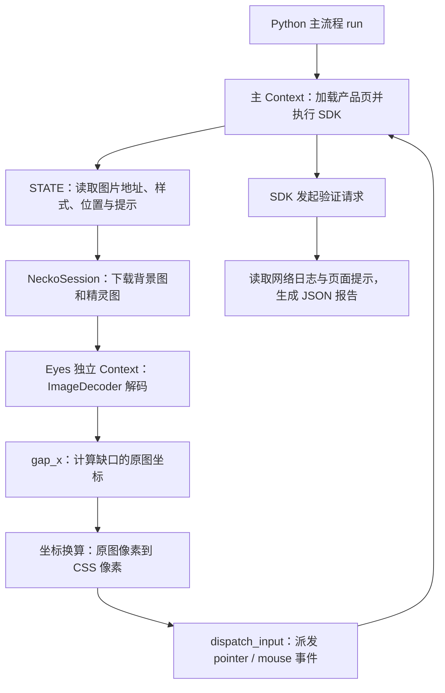

# 腾讯天御验证码：ruyijs 技术讲解

## 使用说明

运行环境：Windows x64、64 位 Python 3.10 或更高版本。先安装 ruyijs：

```powershell
pip install ruyijs
```

进入本示例目录后运行：

```powershell
python tianyu.py
python tianyu.py --mode slide --output tianyu.json
```

第一条命令依次执行无感验证和滑块拼图；第二条仅执行滑块拼图，并将结果写入 JSON 文件。运行时保留仓库目录结构，脚本会引用 [google_search.py](../google/google_search.py) 中的 `NeckoSession`。代理、超时和其他参数见第 8 节，完整示例代码附在文末。

本示例通过 [tianyu.py](./tianyu.py) 驱动腾讯云验证码产品页的体验区，覆盖无感验证和滑块拼图两种流程。核心思路是：由 ruyijs 执行页面 SDK，由 Python 读取页面状态、识别拼图位置并驱动输入，最后依据页面结果判断是否成功。

本文按执行链路解释现有实现，适合技术分享和结合源码阅读。页面地址为 `https://cloud.tencent.cn/product/captcha`；文中的部署参数与历史观测对应原示例记录，实时行为以当前页面和运行报告为准。

## 1. 整体架构：页面执行、图像处理与流程控制



| 层次 | 主要组件 | 职责 |
| --- | --- | --- |
| 流程控制 | Python、`run()`、`main()` | 选择模式、等待状态、控制拖动、记录尝试和汇总结果 |
| 页面执行 | 主 `Context` | 加载页面、运行 SDK、维护 DOM、处理事件和定时任务 |
| 网络传输 | 页面网络适配器、独立 `NeckoSession` | 承载页面请求；为图像处理直接获取图片字节 |
| 图像处理 | `Eyes`、`DECODE`、`gap_x()` | 将图片解码为 RGBA，提取形状并搜索缺口 |

这里的 ruyijs 提供 JavaScript 执行和原生 Web API 环境。验证参数由页面 SDK 在运行过程中生成；Python 通过 `Context.eval()` 读取 DOM，并设置页面切换标记。因此，准确的描述是“运行原页面 SDK 并通过宿主控制输入”，其中包含辅助 JavaScript 表达式的执行。

`Eyes` 使用独立上下文承载图片解码，将文档 URL 设置为图片服务的 origin：`https://turing.captcha.qcloud.com/`。图片下载实际由它持有的 `NeckoSession.send()` 完成，随后将字节交给解码上下文；该上下文与主页面的状态各自独立。

## 2. 请求链路：从体验按钮到验证结果

原示例参考的 Firefox trace 为 `jscall-detail-desktop-20261022-155307`，记录的主要链路如下：

```text
产品页 → TJCaptcha.js → tgJCap.js → cap_union_prehandle
      → tdc.js（设备信息采集）→ cap_union_new_verify
```

`TJCaptcha.js` 提供页面调用的 `TencentCaptcha` 入口，后续脚本承接组件逻辑；`cap_union_prehandle` 返回挑战配置；`tdc.js` 参与设备信息采集；组件在完成相应交互后提交 `cap_union_new_verify`。

| 模式 | 体验按钮 | 历史 aid / subcapclass | 交互方式 |
| --- | --- | --- | --- |
| 无感验证 | `#noFeel_click` | `198550928` / `1001` | 点击后等待验证请求和成功提示 |
| 滑块拼图 | `#captcha_click` | `192962660` / `2401` | 等待拼图、识别缺口、拖动并松开 |

历史无感验证响应包含 `errorCode: 0` 和 ticket。滑块配置中，画布为 672×480，背景图片为 672×390，拼图块来自精灵图中的 120×120 区域；初始 x 为 50，可拖动范围为 `[50, 552]`。这些数值用于理解当时的部署，其中原图宽度 `672` 也被当前脚本直接用于坐标换算。

滑块答案在历史请求中使用 `DynAnswerType_POS`，表达拼图块在原图坐标系中的 `x,y`。trace 曾记录第一次给出 174 后返回 `errorCode: 50`，刷新后第二次给出 304 并通过；两次对应不同挑战，单凭这组记录不足以确定第一次失败的具体原因。

## 3. 页面调度：等待明确状态，再进行下一步

`load()` 在导航前设置 `window.__previous`，随后等待三个条件同时成立：旧标记消失、目标按钮存在、`TencentCaptcha` 已成为函数。这能区分旧页面与新页面，避免在 SDK 尚未就绪时操作。

`STATE` 汇总背景图 URL、精灵图 URL、拼图块内联样式、背景显示宽度、滑块矩形和提示文字。同类组件存在多个节点时，选择最后一个匹配项；成功提示通过元素尺寸和文字检查。该方式依赖当前页面的 DOM 结构。

主上下文使用 `configure_clock("system")`。等待通过 `advance()` 推动定时任务和引擎任务执行；系统时钟模式包含实际等待。Python 使用 `monotonic()` 计算期限和拖动进度，事件处理本身的耗时也会计入进度。

`--mode all` 会先做无感验证，再重新加载产品页进行滑块验证。每次操作前记录验证请求数量，操作后等待 `cap_union_new_verify` 日志增加，再推进页面任务并读取提示。

## 4. 图像识别：用拼图形状寻找局部亮度差

### 4.1 从图片字节到 RGBA

`Eyes.rgba()` 先下载图片并检查 HTTP 状态，再通过 Base64 将字节传入独立上下文。`DECODE` 调用 `ImageDecoder.decode()`，用 `copyTo(..., {format: "RGBA"})` 取得像素，最终向 Python 返回 `(width, height, rgba_bytes)`。当前调用将背景指定为 JPEG、精灵图指定为 PNG。

精灵图包含拼图块素材及其透明区域。代码根据页面样式算出拼图块在精灵图中的裁剪位置，再用 Alpha 通道恢复形状：透明度大于 128 的像素进入内部集合 `inside`。

### 4.2 构造内部与外圈

`gap_x(bg, sprite, piece)` 的 `piece` 包含四项：精灵图中的起点 x、起点 y、拼图块边长，以及拼图块在背景中的 y。已知纵向位置后，只需沿水平方向搜索。

对每个内部像素，代码检查横纵偏移均在 `[-3, 3]` 的邻域，把位于形状外、且仍在拼图块方框内的像素加入外圈 `ring`。之后对内部和外圈各隔一个样本取一个，减少评分计算量。

### 4.3 亮度评分与搜索

背景像素的亮度近似为 `L = (30R + 59G + 11B) // 100`。对候选横坐标 x，将形状覆盖到背景上，计算：

```text
score(x) = 形状内部平均亮度 − 形状外圈平均亮度
gapX     = 搜索范围内 score(x) 最小的位置
```

这一评分利用了当前拼图样式的特征：缺口内部相对变暗，边缘附近带亮色描边。比较内部与邻近外圈，能表达局部亮度差；背景纹理仍可能影响结果。

代码先缓存目标高度范围内的亮度值，再以 4 像素步长粗搜索，最后在粗搜索最佳点前后 4 像素内逐像素细搜。返回值是**拼图块外框左缘的原图横坐标**。方法依赖透明形状、已知纵向位置和局部亮度特征，适用范围由这些条件决定。

## 5. 坐标换算：原图、页面和鼠标的位置

识别算法使用原图像素，页面布局和输入事件使用 CSS 像素。`run()` 先取得背景元素的显示宽度，再计算缩放比例：

```python
scale = (bgWidth or 330) / 672
piece_x = round(-background_position_x / scale)
piece_y = round(-background_position_y / scale)
piece_size = round(css_piece_width / scale)
piece_top = round(css_piece_top / scale)
goal = gapX * scale
distance = goal - left0
```

`background-position` 的负值表示将整张精灵图向左、向上移动，从而露出指定区域；反向取值并除以比例即可恢复素材裁剪起点。`left0` 是拼图块拖动前的 CSS `left`，`goal` 是期望的 CSS `left`，两者相减才是鼠标应移动的距离。

例如，背景显示宽度为 336、原图宽度为 672，则 `scale = 0.5`。如果 `gapX = 304`、初始 `left0 = 25`，目标位置为 152 CSS px，鼠标需要移动 127 CSS px。鼠标起点另由滑块的 `getBoundingClientRect()` 计算，属于视口坐标。

当前代码从内联样式读取 `background-position`、`width`、`left`、`top`，采用统一的背景缩放比例。`background-size` 没有单独参与解析；页面缩放规则或素材原始尺寸变化时，需要重新核对这个假设。

## 6. 输入驱动：按时间推进，并读取页面位置校正

`mouse()` 每次先派发对应的 PointerEvent，再派发 MouseEvent，例如 `pointermove → mousemove`。事件包含坐标、按键状态、冒泡属性以及 pointer 标识。`dispatch_input()` 由运行时原生输入接口创建可信事件，目标元素由调用方明确指定；接口本身没有自动命中测试或自动生成兼容鼠标事件的行为。

滑块交互分为以下阶段：

1. **接近与按下**：用 12 个移动步骤接近滑块，短暂停留，再发送按下事件。
2. **快速移动**：使用 `1 - (1 - q)²` 的缓动曲线，移动到目标前方的一小段距离。
3. **缓慢靠近**：按时间进度补足余下距离，快速和慢速阶段的配置时长合计约 0.95～1.5 秒。
4. **位置校正**：读取当前拼图块的 CSS `left`，将与 `goal` 的差值补到鼠标坐标上，最多校正 4 次，误差小于 0.6 CSS px 时停止。
5. **停留与松开**：停留 200～400 ms 后发送松开事件，等待页面提交验证并更新结果。

这里形成了一个位置反馈过程：计算目标 → 输入事件 → 页面更新拼图块 → 读取实际位置 → 修正剩余误差。完整交互还包括接近、按下前后的等待及事件处理耗时，因此总用时会超过两段移动的配置时长。

每次移动后调用 `advance(16)` 以推进页面任务；它表达推进时间，并不保证固定 60 Hz 的事件频率。布局计算或事件处理较慢时，实际移动点数会减少。

验证失败后，代码最多推进 16 轮任务，尝试等到背景图 URL 改变且滑块节点存在，再进入下一次尝试。等待轮数耗尽后仍会继续下一轮，因此这里是有界等待，下一轮开始时新图是否已就绪取决于页面状态。

## 7. 结果判定：页面反馈、HTTP 状态与业务响应

| 信息 | 来源 | 在当前脚本中的含义 |
| --- | --- | --- |
| `status` | `Context.net_log()` | 验证请求的 HTTP 状态码，例如 200 |
| `errorCode`、ticket | 历史 trace 的接口响应 | 服务端业务响应，用于解释请求链路 |
| 模式内 `passed` | 页面 DOM | 可见组件提示含“验证成功”，或可见叶子节点文字为“验证成功” |
| 顶层 `passed` | 结果汇总 | 各已执行模式通过，且捕获的异常中没有匹配腾讯验证码域名的堆栈 |

HTTP 200 本身只说明请求的 HTTP 状态。当前报告以页面提示判定模式是否成功，业务响应中的 `errorCode` 和 ticket 尚未提取到输出中。

以下是**字段结构示意**，数值用于说明含义，并非本次整理文档产生的实测结果：

```json
{
  "passed": true,
  "transport": "ruyijs-parameters+necko",
  "proxy": null,
  "scriptErrors": [],
  "slide": {
    "attempts": [
      {
        "gapX": 304,
        "goal": 152.0,
        "releasedAt": 152.0,
        "moves": 12,
        "status": 200,
        "error": null,
        "passed": true
      }
    ],
    "passed": true
  },
  "elapsedSeconds": 30.0
}
```

`gapX` 使用原图像素；`goal` 和 `releasedAt` 使用 CSS 像素。`moves` 只统计按下后的主拖动与校正步骤，接近滑块的 12 次移动另计；每个步骤包含 pointer 和 mouse 两次派发。尝试内的 `error` 是页面错误提示，顶层的 `error` 则记录被主流程捕获的异常。

`scriptErrors` 收集任务推进时捕获的 `JSError`，按消息去重、最多 10 条，消息和堆栈分别截取前 200 字符。汇总时检查堆栈是否包含 `captcha.qcloud.com` 或 `captcha.gtimg.com`，因此异常检查的范围受捕获方式、条数和截断长度约束。进程正常生成报告后，顶层 `passed` 为真时退出码为 0，否则为 1。

## 8. 运行方式与依赖

环境要求为 Windows x64、64 位 Python 3.10+，以及包含所需 Web API 和 Necko 组件的 ruyijs 运行时。安装入口见[项目说明](../../README.zh-CN.md)。本脚本还引用 [google_search.py](../google/google_search.py) 中的 `NeckoSession`，运行时需保留对应示例目录结构。

源码运行会优先检查项目根目录的 `dist/js.exe` 或环境变量 `RUYIJS_SHELL`，条件成立时导入仓库内的 Python 包；其他情况使用已安装的包。Necko 辅助进程依赖选定运行时内的 `vendor/necko-derived/python/python.exe` 及其配套文件。

在项目根目录执行：

```powershell
python "examples/腾讯天御/tianyu.py" --help
python "examples/腾讯天御/tianyu.py" --mode nofeel --direct
python "examples/腾讯天御/tianyu.py" --mode slide --proxy http://127.0.0.1:7890 --output tianyu.json
python "examples/腾讯天御/tianyu.py" --mode all --attempts 3 --timeout 90
```

也可进入本目录执行 `python tianyu.py`。报告默认打印到标准输出，`--output` 会额外写入 UTF-8 JSON 文件，并创建所需父目录。

| 参数 | 默认值 | 作用 |
| --- | --- | --- |
| `--mode` | `all` | `all`、`nofeel` 或 `slide` |
| `--proxy` | 自动选择 | 显式指定 HTTP(S) 代理，与 `--direct` 互斥 |
| `--direct` | 关闭 | 显式选择直连 |
| `--attempts` | `3` | 滑块总尝试次数，包含第一次；使用正整数 |
| `--timeout` | `90` | 主页面调用共用的期限，单位秒，要求正有限数 |
| `--output` | 未设置 | 同时将报告写入指定文件 |

自动选择代理时，顺序为 `HTTPS_PROXY`、`https_proxy`、`HTTP_PROXY`、`http_proxy`、探测本机 `127.0.0.1:7890`，最后选择直连。它在开始时选择配置，没有逐个代理失败后自动切换的流程。

主页面调用会按剩余期限更新超时；`Eyes` 使用独立的 60 秒上下文超时，其图片下载和解码未接入主期限包装，因此 `--timeout` 对整个进程的实际墙钟时长约束并非严格一致。原示例曾记录两种模式合计约 50 秒，这一历史耗时包含两次页面加载。

## 9. 性能案例：DOM 与布局开销如何影响输入节奏

原示例记录的产品页含 1485 条 CSS 规则，其中包含 `:has()`。页面的 `mousemove` 处理函数反复修改 class 和内联样式，再读取布局；运行时若在每次写入后重建存活集合或进行大范围布局重算，就会放大单次输入成本。

相关修复把存活集合的刷新推迟到读取时，并根据变更影响范围复用布局；选择器依赖需要扩大计算范围时，再触发相应重算。同期还将 `document.getElementsByName()` 的返回类型修正为存活 `NodeList`。

owner 文档记录该页面的单次 `mousemove` 耗时从约 360 ms 降至约 88 ms。这说明事件吞吐量与 DOM、样式、布局实现紧密相关，也解释了为什么增加轨迹点的配置并不直接等于增加实际事件密度。这些数字来自历史记录，具体机制和后续演进见 [DOCUMENT_MODEL.md](../../docs/owners/DOCUMENT_MODEL.md) 与 [WEB_GEOMETRY.md](../../docs/owners/WEB_GEOMETRY.md)。

原 README 另记载过将拖动目标偏移 40 px 后判为失败的反向检查，可作为当时结果判定的补充证据；本次文档整理没有重新执行该检查。

## 10. 源码阅读顺序与定位问题

建议按 `main()` → `run()` → `load()/STATE` → `Eyes.rgba()/DECODE` → `gap_x()` → 坐标换算与拖动循环 → 结果汇总的顺序阅读 [tianyu.py](./tianyu.py)。这样可以先建立流程，再理解每个算法的输入和输出。

| 现象 | 优先检查的位置 |
| --- | --- |
| 导入或 Necko 启动报错 | ruyijs 包、运行时目录及 `google_search.py` 的引用路径 |
| 等待按钮或拼图超时 | 代理配置、页面可达性、SDK 就绪条件和 DOM 选择器 |
| 图片请求或解码报错 | 图片 URL、HTTP 状态、JPEG/PNG 类型假设和 `ImageDecoder` 支持 |
| 拼图位置偏差较大 | `gapX`、背景原始宽度、CSS 缩放比例及精灵图裁剪坐标 |
| 移动点数少或位置校正不足 | `moves`、`goal` 与 `releasedAt` 的差值、事件和布局耗时 |
| HTTP 200 但 `passed` 为假 | 页面错误提示、成功提示是否出现、组件刷新状态及 `scriptErrors` |

## 附录：完整示例代码

以下代码完整摘录自 [tianyu.py](./tianyu.py)，便于与前文讲解对照阅读。运行依赖和目录结构见开头使用说明及第 8 节。

```python
"""腾讯天御验证码（cloud.tencent.cn/product/captcha 体验区）：ruyijs+necko 原生环境完成「无感验证」与「滑块拼图」。

python tianyu.py
python tianyu.py --mode slide --proxy http://127.0.0.1:7890 --output tianyu.json
python tianyu.py --direct

流程（与 Firefox trace jscall-detail-desktop-20261022-155307 一致）：产品页 -> TJCaptcha.js -> tgJCap.js ->
cap_union_prehandle -> tdc.js（设备信息）-> cap_union_new_verify。
- 无感验证（#noFeel_click，aid 198550928，subcapclass 1001）：点击按钮，verify 直接返回 errorCode 0 与 ticket。
- 滑块拼图（#captcha_click，aid 192962660，subcapclass 2401）：弹出拼图（背景 672x390，精灵图里的拼图块
  120x120），把滑块拖到缺口处松开，verify 的答案是拼图块在 672 宽坐标系下的位置。trace 中第一次被拒
  （errorCode 50）、刷新后第二次通过；本脚本被拒时同样等待新拼图后重试，最多 --attempts 次。

缺口位置由求解端自己"看图"：另开一个 ruyijs Context（同源 turing.captcha.qcloud.com）取回背景与精灵图，用
ImageDecoder 解码；拼图块的形状取自精灵图的透明通道，缺口是背景上同形状的变暗区域，在拼图块所在的那几行
横向滑动，取"形状内平均亮度 - 形状外一圈平均亮度"最小的位置。拖动按真实时间进行（快速滑到缺口前，慢慢靠上，
停一下再松开）。挑战页面不注入脚本、不替换浏览器 API、不生成 verify 参数；鼠标事件都是可信的 pointer/mouse 事件。
退出码 0 表示所选模式都显示「验证成功」且没有腾讯验证码脚本异常。
"""
import argparse
import base64
import json
import math
import os
from pathlib import Path
import random
import re
import socket
import sys
from time import monotonic

ROOT = Path(__file__).resolve().parents[2]
sys.dont_write_bytecode = True
if (ROOT / "dist" / "js.exe").is_file() or os.environ.get("RUYIJS_SHELL"):
    sys.path.insert(0, str(ROOT / "python"))
sys.path.insert(0, str(ROOT / "examples" / "google"))
from google_search import NeckoSession
from ruyijs import Context, JSError

URL = "https://cloud.tencent.cn/product/captcha"
P = "tencent-captcha-dy__"
LAST = "(()=>{const l=document.querySelectorAll('.%s');return l[l.length-1]})()"
SLIDER = LAST % (P + "slider-block")
STATE = """(()=>{const last=c=>{const l=document.querySelectorAll('.%s'+c);return l[l.length-1]||null};
  const fg=last('fg-item'),bg=last('verify-bg-img'),sl=last('slider-block'),speed=last('verify-speed'),err=last('verify-error-text');
  const url=e=>{const m=e&&(e.getAttribute('style')||'').match(/url\\(([^)]+)\\)/);return m?m[1]:null};
  const box=e=>{if(!e)return null;const b=e.getBoundingClientRect();return [b.left,b.top,b.width,b.height]};
  const shown=e=>{const b=e.getBoundingClientRect();return b.width>0&&b.height>0};
  const toast=[...document.querySelectorAll('body *')].some(e=>e.childElementCount===0&&e.textContent.trim()==='验证成功'&&e.getBoundingClientRect().width>0);
  return {fg:url(fg),bg:url(bg),fgStyle:fg?fg.getAttribute('style'):null,bgWidth:bg?bg.getBoundingClientRect().width:0,
    slider:box(sl),speed:speed&&shown(speed)?speed.textContent.trim():'',error:err&&shown(err)?err.textContent.trim():'',toast}})()""" % P
DECODE = """(async (b64, type) => { const bytes = Uint8Array.from(atob(b64), c => c.charCodeAt(0));
  const image = (await new ImageDecoder({data: bytes, type}).decode()).image;
  const out = new Uint8Array(image.allocationSize({format: 'RGBA'})); await image.copyTo(out, {format: 'RGBA'});
  let s = ''; for (let i = 0; i < out.length; i += 8192) s += String.fromCharCode.apply(null, out.subarray(i, i + 8192));
  return [image.codedWidth, image.codedHeight, btoa(s)]; })"""


def auto_proxy():
    for name in ("HTTPS_PROXY", "https_proxy", "HTTP_PROXY", "http_proxy"):
        if os.environ.get(name):
            return os.environ[name]
    try:
        with socket.create_connection(("127.0.0.1", 7890), timeout=.3):
            return "http://127.0.0.1:7890"
    except OSError:
        return None


class Eyes:
    """A separate ruyijs Context that only fetches and decodes the puzzle images (same origin)."""

    def __init__(self, proxy):
        self.context = Context(proxy=proxy or None, timeout=60)
        self.necko = NeckoSession(proxy)
        self.context.load_page("https://turing.captcha.qcloud.com/", "<!doctype html><title>solver</title>")

    def rgba(self, url, kind):
        c = self.context
        status, _, payload, _ = self.necko.send("GET", url, [("Accept", "image/*")])
        if status < 200 or status >= 300:
            raise RuntimeError("图片请求 HTTP %s: %s" % (status, url))
        encoded = base64.b64encode(payload).decode("ascii")
        c.eval("window.__img=null;(%s)(%s,%s).then(v=>{__img=v},e=>{__img=String(e)});0"
               % (DECODE, json.dumps(encoded), json.dumps(kind)))
        value = None
        for _ in range(400):
            c.advance(25)
            value = c.eval("__img")
            if value is not None:
                break
        if not isinstance(value, list):
            raise RuntimeError("图片解码失败: %s %s" % (url[:80], value))
        return value[0], value[1], base64.b64decode(value[2])

    def close(self):
        self.context.close()
        self.necko.close()


def gap_x(bg, sprite, piece):
    """缺口在背景中的横向位置（背景像素坐标，即拼图块外框左缘）。

    piece = (精灵图中的 x, y, 边长, 拼图块在背景中的 y)。缺口是同形状的变暗区域（带白色描边）。"""
    bw, bh, bp = bg
    sw, _, sp = sprite
    px, py, size, y = piece
    inside = [(x, yy) for yy in range(size) for x in range(size) if sp[((py + yy) * sw + px + x) * 4 + 3] > 128]
    solid = set(inside)
    ring = set()
    for x, yy in inside:
        for dx in range(-3, 4):
            for dy in range(-3, 4):
                if (x + dx, yy + dy) not in solid and 0 <= yy + dy < size and 0 <= x + dx < size:
                    ring.add((x + dx, yy + dy))
    ring = sorted(ring)
    light = lambda x, yy: (bp[(yy * bw + x) * 4] * 30 + bp[(yy * bw + x) * 4 + 1] * 59 + bp[(yy * bw + x) * 4 + 2] * 11) // 100
    inside, ring = inside[::2], ring[::2]
    if y + size > bh:
        return 0
    # The band's brightness once, then a coarse scan (4 px) refined around its best offset.
    band = {(x, yy): light(x, y + yy) for yy in range(size) for x in range(bw)}

    def score(offset):
        a = sum(band[offset + x, yy] for x, yy in inside) / len(inside)
        b = sum(band[offset + x, yy] for x, yy in ring) / len(ring)
        return a - b
    last = bw - size - 1
    coarse = min(range(0, last + 1, 4), key=score)
    return min(range(max(0, coarse - 4), min(last, coarse + 4) + 1), key=score)


def px(style, name):
    m = re.search(r"(?:^|;)\s*%s:\s*(-?[0-9.]+)px(?:\s+(-?[0-9.]+)px)?" % re.escape(name), style)
    return (float(m.group(1)), float(m.group(2) or 0)) if m else (0.0, 0.0)


def run(args, report):
    deadline = monotonic() + args.timeout
    proxy = report["proxy"]
    with Context(proxy=proxy or None, timeout=args.timeout) as context:
        def call(method, *values, **kwargs):
            remaining = deadline - monotonic()
            if remaining <= 0:
                raise TimeoutError("等待页面超时")
            context.timeout = remaining
            return method(*values, **kwargs)

        def advance(ms=250):
            try:
                call(context.advance, ms, max_tasks=500)
            except JSError as error:
                entry = {"name": error.name, "message": error.message[:200], "stack": (error.stack or "")[:200]}
                if not any(e["message"] == entry["message"] for e in report["scriptErrors"]) and len(report["scriptErrors"]) < 10:
                    report["scriptErrors"].append(entry)

        def state():
            return call(context.eval, STATE)

        def verifies():
            return [r for r in call(context.net_log) if "/cap_union_new_verify" in r["url"]]

        def mouse(kind, x, y, buttons, target):
            init = dict(clientX=x, clientY=y, screenX=x + 8, screenY=y + 120, buttons=buttons, button=0,
                        bubbles=True, cancelable=True, composed=True)
            pointer = {"mousedown": "pointerdown", "mousemove": "pointermove", "mouseup": "pointerup"}[kind]
            call(context.dispatch_input, pointer, target=target, pointerId=1, pointerType="mouse", isPrimary=True,
                 pressure=0.5 if buttons else 0, **init)
            call(context.dispatch_input, kind, target=target, **init)

        def click(button):
            target = "document.getElementById(%s)" % json.dumps(button)
            box = call(context.eval, "(()=>{const b=%s.getBoundingClientRect();return [b.left,b.top,b.width,b.height]})()" % target)
            x, y = round(box[0] + box[2] / 2), round(box[1] + box[3] / 2)
            mouse("mousemove", x, y, 0, target)
            advance(random.randint(80, 160))
            mouse("mousedown", x, y, 1, target)
            advance(random.randint(60, 120))
            mouse("mouseup", x, y, 0, target)
            call(context.dispatch_input, "click", target=target, clientX=x, clientY=y, button=0, bubbles=True, cancelable=True)

        def load(button):
            # Wait for the new document (not the previous one) to show the button and
            # the captcha SDK (TJCaptcha.js defines TencentCaptcha) to be ready.
            call(context.eval, "window.__previous=1;0")
            call(context.navigate, URL)
            ready = "!window.__previous&&!!document.getElementById(%s)&&typeof TencentCaptcha=='function'" % json.dumps(button)
            while not call(context.eval, ready):
                advance(100)
            advance(300)

        call(context.configure_clock, "system")
        if args.mode in ("all", "nofeel"):
            load("noFeel_click")
            sent = len(verifies())
            click("noFeel_click")
            while len(verifies()) <= sent:
                advance()
            for _ in range(4):
                advance()
            s = state()
            report["nofeel"] = {"status": verifies()[-1]["status"], "passed": "验证成功" in s["speed"] or s["toast"]}
        if args.mode in ("all", "slide"):
            eyes = Eyes(proxy)  # its own process starts while the page loads
            load("captcha_click")
            click("captcha_click")
            while not (state()["fg"] and state()["slider"]):
                advance()
            advance(250); advance(250)
            report["slide"] = {"attempts": [], "passed": False}
            try:
                last_bg = None
                for _ in range(args.attempts):
                    s = state()
                    last_bg = s["bg"]
                    sent = len(verifies())
                    style = s["fgStyle"]
                    scale = (s["bgWidth"] or 330) / 672
                    pos_x, pos_y = px(style, "background-position")
                    size = round(px(style, "width")[0] / scale)
                    left0, top = px(style, "left")[0], px(style, "top")[0]
                    piece = (round(-pos_x / scale), round(-pos_y / scale), size, round(top / scale))
                    bg, sprite = eyes.rgba(s["bg"], "image/jpeg"), eyes.rgba(s["fg"], "image/png")
                    target = gap_x(bg, sprite, piece)
                    goal = target * scale  # the piece's displayed left at the gap
                    bx, by, bw, bh = s["slider"]
                    x, y = round(bx + bw / 2 + random.uniform(-5, 5)), round(by + bh / 2 + random.uniform(-4, 4))
                    hx, hy = x - random.uniform(80, 160), y + random.uniform(30, 80)
                    for i in range(1, 13):  # approach the slider
                        q = i / 12
                        e = q * q * (3 - 2 * q)
                        mouse("mousemove", round(hx + (x - hx) * e), round(hy + (y - hy) * e), 0, SLIDER)
                        advance(random.choice((16, 17, 24, 33)))
                    advance(random.randint(200, 500))
                    mouse("mousedown", x, y, 1, SLIDER)
                    advance(random.randint(90, 160))
                    # Real-time drag: a fast run to a few px short of the gap, a slow approach, a short hold.
                    distance = goal - left0
                    short = random.uniform(6, 14)
                    fast, slow = random.uniform(.45, .7), random.uniform(.5, .8)
                    cx, cy, moves, began = x, y, 0, monotonic()
                    while True:
                        t = monotonic() - began
                        if t >= fast + slow:
                            break
                        if t < fast:
                            q = t / fast
                            cx = x + (distance - short) * (1 - (1 - q) ** 2)
                            cy = y + round(random.uniform(0, 4) * q)
                        else:
                            cx = x + distance - short * (1 - (t - fast) / slow)
                        mouse("mousemove", round(cx), cy, 1, SLIDER)
                        advance(16)
                        moves += 1
                    for _ in range(4):  # land on the gap, reading the piece's position
                        left = px(state()["fgStyle"], "left")[0]
                        if abs(goal - left) < 0.6:
                            break
                        cx += goal - left
                        mouse("mousemove", round(cx), cy, 1, SLIDER)
                        advance(16)
                        moves += 1
                    released = px(state()["fgStyle"], "left")[0]
                    advance(random.randint(200, 400))
                    mouse("mouseup", round(cx), cy, 0, SLIDER)
                    while len(verifies()) <= sent:
                        advance()
                    for _ in range(4):
                        advance()
                    s = state()
                    passed = "验证成功" in s["speed"] or s["toast"]
                    report["slide"]["attempts"].append({"gapX": target, "goal": round(goal, 1), "releasedAt": round(released, 1),
                                                        "moves": moves, "status": verifies()[-1]["status"],
                                                        "error": s["error"] or None, "passed": passed})
                    if passed:
                        report["slide"]["passed"] = True
                        break
                    for _ in range(16):  # 被拒：等待组件刷新出新拼图
                        advance()
                        s = state()
                        if s["bg"] and s["bg"] != last_bg and s["slider"]:
                            break
            finally:
                eyes.close()
        tencent = [e for e in report["scriptErrors"] if "captcha.qcloud.com" in e["stack"] or "captcha.gtimg.com" in e["stack"]]
        report["passed"] = all(report[m]["passed"] for m in ("nofeel", "slide") if m in report) and not tencent
        context.timeout = min(5, max(1, deadline - monotonic()))


def main():
    if hasattr(sys.stdout, "reconfigure"):
        sys.stdout.reconfigure(encoding="utf-8")
    parser = argparse.ArgumentParser(description=__doc__, formatter_class=argparse.RawDescriptionHelpFormatter)
    proxy = parser.add_mutually_exclusive_group()
    proxy.add_argument("--proxy", help="HTTP(S) 代理，默认环境变量/本机 7890/直连")
    proxy.add_argument("--direct", action="store_true", help="直接连接")
    parser.add_argument("--mode", choices=("all", "nofeel", "slide"), default="all", help="验证模式，默认两种都做")
    parser.add_argument("--attempts", type=int, default=3, help="滑块被拒时最多尝试的次数")
    parser.add_argument("--timeout", type=float, default=90, help="总期限，秒")
    parser.add_argument("--output", type=Path, help="将 JSON 结果同时写入此文件")
    args = parser.parse_args()
    if not math.isfinite(args.timeout) or args.timeout <= 0:
        parser.error("--timeout 必须是正有限数")
    report = {"passed": False, "transport": "ruyijs-parameters+necko", "proxy": None if args.direct else (args.proxy or auto_proxy()), "scriptErrors": []}
    started = monotonic()
    try:
        run(args, report)
    except Exception as error:
        report.update(passed=False, error=type(error).__name__ + ": " + str(error))
    report["elapsedSeconds"] = round(monotonic() - started, 3)
    text = json.dumps(report, ensure_ascii=False, indent=2)
    if args.output:
        args.output.parent.mkdir(parents=True, exist_ok=True)
        args.output.write_text(text + "\n", "utf-8")
    print(text)
    return 0 if report["passed"] else 1


if __name__ == "__main__":
    raise SystemExit(main())
```
